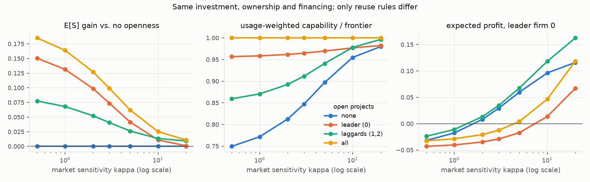

# ai-institutions

[English](README.md)

**研究问题**：在相同研发预算下，技术开放程度、所有权和融资结构，如何影响创新、收入分配及风险承担？

本项目不预设哪一种制度更好。所有结论都是模型推导出的条件性结论，并写明成立条件。

## 状态

`v0.1`：单期模型、核算检查和三个实验（分配、研发、开放）都已完成。

进行中：多期草稿模型（model.md §11）；内生定价份额（§12，实验 `experiments/pricing.py`，结论 F7、F8）；内生私人投资（§13，实验 `experiments/investment.py`，结论 F9）；开源外溢的摩擦（§14，实验 `experiments/spillovers.py`，结论 F10）；公共实验室与私人厂商共存（§15，实验 `experiments/mixed.py`，结论 F11）。

- 模型规范：[docs/model.md](docs/model.md)
- 结论及其成立条件：[docs/findings.md](docs/findings.md)
- 代码：[src/ai_institutions/](src/ai_institutions/)，与 model.md 的章节一一对应
- 实验：[experiments/](experiments/)，结果在 [results/](results/)



*只改变复用规则：市场越不集中于最好的模型（κ 越小），开放带来的价值增量越大（见 findings F6）。*

## 动画：四种制度的 25 期演化（多期草稿模型）

开源/闭源 × 私人/公共，相同预算、相同随机冲击。拨动开关，看 100 个人的得失、厂商“爬山”、资金流向和 50 条可能的历史。其他开关切换假设：劳动收入替代、定价方式、私人研发投入方式，以及开源外溢是否有摩擦（无摩擦时开源结果是上限，见 F10）。

- **在线打开**：[中文](https://shaoxiongyao.github.io/ai-institutions/results/dynamics/) · [English](https://shaoxiongyao.github.io/ai-institutions/results/dynamics/en/)
- 离线打开：下载 [results/dynamics/index.html](results/dynamics/index.html)（完整独立页面，约 10MB），直接用浏览器打开
- `results/dynamics/explainer.html`：同样内容的页面片段，即发布到 Claude Artifact 的文件
- 英文版：[results/dynamics/en/index.html](results/dynamics/en/index.html)（English version；片段为 `results/dynamics/en/explainer.html`）
- 源文件：[viz/dynamics.html](viz/dynamics.html)（中文）、[viz/dynamics.en.html](viz/dynamics.en.html)（英文，两者互为翻译，改动时需同步）；数据：`results/dynamics/trajectories.json`

重新生成（同一随机种子下，除运行记录 `run_info` 外，数据与已提交版本完全相同）：

```bash
uv run python -m experiments.dynamics && uv run python -m experiments.build_viz
```

## 复现

```bash
uv sync
uv run pytest                          # 核算恒等式与边界情况
uv run python -m experiments.run_all   # 三个实验，结果写入 results/
```

每个 `results/<实验>/summary.json` 都记录配置、随机种子、抽样次数和 git commit。

## 修改一个假设

基线参数在 [experiments/common.py](experiments/common.py) 中。修改后重新运行，再对照 findings 里的"敏感性"一栏，就能看到结论是否改变。

## 引用

作者：Shaoxiong Yao。引用格式见 [CITATION.cff](CITATION.cff)（GitHub 页面右侧的 "Cite this repository"）或英文 [README](README.md#citation)。

## 许可证

- 代码（`src/`、`experiments/`、`tests/` 及 `viz/` 中的脚本）：[Apache License 2.0](LICENSE)
- 文档、图表、结果和动画页面的文字：[CC BY 4.0](LICENSE-docs.md)
